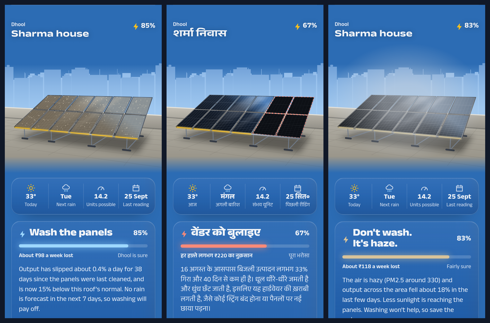
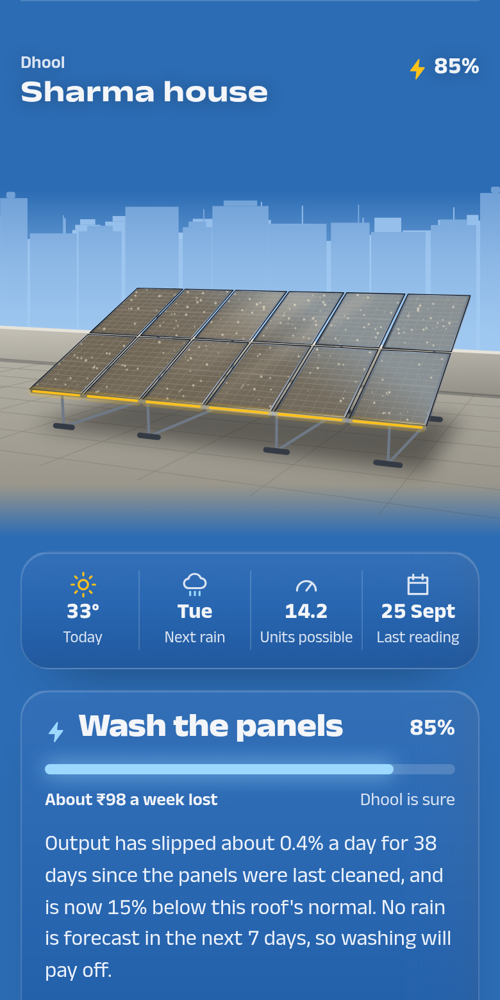
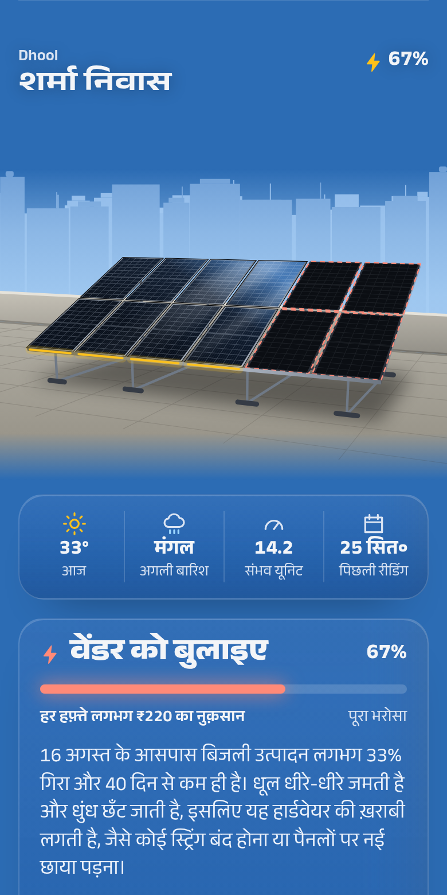
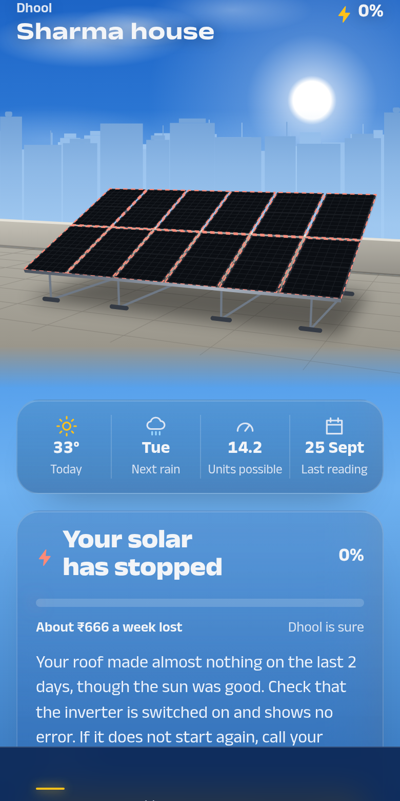

# The Roof That Made Nothing, and the App That Said It Was Fine

_Subtitle for Builder Center: I built an app to tell Indian households whether their rooftop solar is working. Then real data showed me, five separate times, that I had modelled the world wrong. This is what each one cost._

_Tags: aws-lambda, serverless, amazon-dynamodb, amazon-cognito, aws-sam_



_Sample homes from the app's preview page: wash the panels, call your vendor (in Hindi), and don't wash because it is haze._

---

**A rooftop solar system made zero units on a clear, sunny day. My app looked at it and said: "Your solar is working. Dhool is sure."**

At that moment 118 tests were passing and the scoring script said the rules were right 93 to 95% of the time. Nothing had failed. A reviewer found it by typing a row of zeros into the rules, which my simulator had never thought to do.

That is the reason this post exists. The AWS wiring mostly worked as planned. The interesting part was the five times something real, a rooftop in Arizona, a screenshot of a Growatt app, a support ticket, a row of zeros, told me my model of the world was wrong, and what it cost each time to listen.

The thing is called Dhool (धूल, "dust"). The source is [on GitHub](https://github.com/Aaryan-Degama/Dhool_aws). _Live app: to be added. Video: to be added._

> **The short version:** I set out to tell people when to wash their solar panels. I shipped something that mostly tells them when not to, and that is honest about what it cannot see. The gap between those two sentences is 62 commits and five corrections.

---

## Part one: the problem is not dust

More than 50 lakh Indian households now have rooftop solar under PM Surya Ghar ([PIB, Aug 2026](https://www.pib.gov.in/PressReleasePage.aspx?PRID=2294208)). Each has an inverter app that shows one number a day: units made.

That number cannot tell you whether anything is wrong. A cloudy day, a dusty panel, a week of smog and a dead string all look the same. The app never shows what the roof *should* have made in that day's weather.

So Dhool computes it: the roof's size, tilt and direction, that day's real weather from Open-Meteo, through pvlib's solar physics. Compare that with what the inverter reported, and name the gap.

My first wash rule was the obvious one: output is 5% down and no rain is due in the next two days, so wash the panels. It ignored two things, and the other verdicts exist because washing is so often the wrong answer:

| What is actually happening | Why "it is down, so wash" is wrong | What Dhool says |
|---|---|---|
| Rain is forecast later this week | The rain washes them for free, and the dust costs little until then | Wait for the rain |
| A dust storm is forecast | The panels are dirty again the day after | Wash after the dust storm |
| The dust costs ₹2 a day and a cleaner charges ₹350 | The wash never pays for itself | Not worth washing yet |
| Smog over the whole city | Less sunlight is reaching every roof | Don't wash. It's haze. Save the water |
| A string has died | Dust builds slowly; this fell in a day and stayed down | Call your vendor |

Washing turned out to be a money decision, so it became one function. A wash wins back today's loss every day until rain or a dust storm undoes it. Dhool says "wash" only when that sum beats what a wash costs *that* household, and it shows both sides:

> Wash now and again after it: ₹700. Wait and wash once after it: ₹200 lost and ₹350 for the wash, ₹550. Waiting is ₹150 cheaper.

A family that pays a cleaner ₹350 gets a different answer from one with a bucket and a free morning. Both are right.

**Correction one.** It deleted a threshold and added a setting, and it is why most of Dhool's advice is "not yet".



---

## Part two: your roof is not the textbook

The physics says what a perfect 3 kW system makes. No roof makes that. Wiring, panel age, a neighbour's water tank: every roof runs at its own share of the textbook figure.

I learned that the embarrassing way. The app showed "should have made 8.86, made 5.52" and, beside it, "2.86 units a day lost". Those three numbers do not add up, because one was the textbook and the other two were measured against the roof's own normal. A homeowner would have spotted it in a second.

So every figure now uses the roof's own normal, learned from its best weeks.

Then I ran the rules on real rooftops: nine homes in California and Arizona from [NREL's PVDAQ data](https://data.openei.org/submissions/4568), about ten years each. My simulator assumed real output scatters 2% a day around the physics. Real roofs scatter 3 to 8%.

| On nine real, mostly healthy rooftops | Months flagged "call your vendor" |
|---|---|
| Fixed threshold, tuned on my simulator | 57% |
| Threshold scaled to each roof's own noise | 9% |

A fixed "10% drop means a fault" was telling healthy households to call the vendor in more than half of all months. The fix is three lines: measure how much that roof's weekly level wanders when nothing is wrong, and make a drop stand well clear of it.

```python
logs = np.log(own.dropna().clip(lower=1e-9))
wander = float(1.4826 * (logs - logs.median()).abs().median()) if len(logs) >= 14 else 0.0
step_drop = min(STEP_DROP, 1 - STEP_WANDERS * wander)
```

On a steady roof 10% is enough. On a noisy one it is not.

**Correction two.** A threshold tuned on data I generated was a threshold tuned on my own assumptions.

---

## Part three: a model may read, never decide

Most households will never find an API key. Everyone can take a screenshot. So Dhool reads the daily units off a screenshot of the inverter app.

The first reader was a small vision model. I asked it the obvious question, "list every daily value on this screen", and it returned a tidy table. It had taken today's number and pinned it on every date under a chart. Plausible, well formatted, and invented.

Two rules came out of that and never left:

- **Ask narrow questions.** "Is this a list of days, a today summary, or neither?" Then "copy the rows", or "today's figure" and "its date". Charts are never read.
- **Whatever a model reads is untrusted.** The API drops any value that cannot be true for a roof of that size, and the homeowner confirms or corrects every number before it is saved.

The verdict itself is never a model's. It is physics and plain rules, and each one carries its reason.

On my own demo inverter's screens the model read 93 of 93 printed values. Then I tried store screenshots of three real apps, Growatt ShinePhone, Sungrow iSolarCloud and SolarEdge.

| Reader, on real-app screenshots (11 printed values) | Right | Invented | Time per screen |
|---|---|---|---|
| Vision model alone | 6 | 1 | 28 to 115 s |
| Plain OCR (Tesseract) and layout rules | 5 | 0 | about 1 s |
| OCR first, the model when OCR finds nothing | 8 | 0 | up to 2 s, or 32 to 70 s when the model is needed |

The honest caveat: I combined the two after seeing each one's result on those same eleven values, so 8 of 11 is not a first-look number. One value is still read wrong (3.41 for 9.76), which is exactly what the confirm screen is for. No homeowner's own screenshot has been tried yet.

OCR had its own lesson. Tesseract read the demo screen's big "5.5" as "3.9", because the print was too large for it. The reader now cuts oversized print out, shrinks it and reads it again.

**Correction three.** A reader that returns nothing is safer than a reader that returns something neat.



---

## Part four: no Bedrock, so the models moved into Lambda

The first design used Bedrock to read screenshots and write explanations. Textract is blocked on the free plan, and AWS Support declined the request to enable Bedrock inference on the account.

So the models are small open ones in Lambda container images: Tesseract and Qwen3-VL-2B (through llama.cpp) for screenshots, and Laya, a small multilingual model fine-tuned to sort a vendor's WhatsApp reply into "coming", "wants something first", "refusing" or "no clear answer". Explanations became fixed sentences, written by hand in English and Hindi, with the figures filled in by code. A fixed sentence cannot hallucinate a rupee.

Two things fought back.

**A fresh container took five and a half minutes to answer.** About four of those were Lambda pulling 1.6 GB of weights out of the image, lazily, as the model server touched them. The fix is to read the file yourself first, in large pieces, many at a time. This is the same trick as it sits in the reply reader:

```python
def _read_piece(offset):
    with open(f"{MODEL}/model.onnx", "rb", buffering=0) as f:
        f.seek(offset)
        f.read(PIECE)

with ThreadPoolExecutor(16) as pool:
    list(pool.map(_read_piece, range(0, os.path.getsize(f"{MODEL}/model.onnx"), PIECE)))
```

For the screenshot model, load-and-prime went from 3 minutes 24 seconds to 14 seconds.

**The weights file was readable by its owner only.** A local `docker run` runs as root and hides that. Lambda does not run as root and does not hide it. `chmod -R a+rX` before the build, and a note in the repo so it is never rediscovered.

**Correction four.** Losing the managed service made the product more predictable, and it made me learn how a container Lambda actually starts.

---

## Part five: the score that flattered me

There is no real inverter brand connected. The demo serves 33 simulated homes: real Delhi weather through the physics, with dust, washes and faults planted in code, never generated by a language model.

Scoring rules against a simulator you wrote yourself is a trap, so I kept a hidden test set: three other cities, every simulator setting redrawn and wider, rules frozen before its first run and never tuned against it. It said 84%. I was pleased with 84%.

A reviewer was not. The simulator builds each home's output from the same physics and the same weather the rules use as "expected", so in simulation the physics is never wrong. And it always hands the rules 29 neighbours to compare with, which a household typing its own numbers does not have.

So I took both advantages away and ran it again.

| Hidden test set, 3,870 checks | Correct | Faults caught |
|---|---|---|
| 29 neighbours, exact weather (what I had been quoting) | 84% | 86% |
| Alone, exact weather | 83% | 66% |
| 29 neighbours, weather about 15% wrong a day | 48% | 37% |
| **Alone, weather about 15% wrong a day** | **56%** | **6 of 433** |

Six of 433. On its own, with imperfect weather, Dhool almost never catches a fault. The simulated weather error is drawn separately for every roof, which is harsher than reality, where neighbours share most of it. It is still the row closest to a real household, so it is the one the README now leads with.

> A number you are pleased with is a number you have not yet tried to break.

**Correction five.** It cost a headline, and it told me what to build next: pool nearby homes' readings, with consent, so every household gets neighbours.

---

## Part six: the bugs that passed every test

Back to the roof that made nothing.

The rules looked at weekly medians. One day at zero inside an otherwise healthy week moves a median by nothing at all, so the verdict was "all good, high confidence". There is now a rule zero: a sunny day at under a tenth of the roof's normal is an outage, unless the whole neighbourhood went down with it, which is a power cut.



The same review found two more, both by feeding the rules data my simulator had never produced:

- **A roof that only ever read zero crashed the analysis** with a division by zero. The household that most needs "call your vendor" got a spinner.
- **Readings typed every three or four days returned "all good, high confidence".** No week had enough readings to learn a normal, the result held a `NaN`, and the browser could not parse it. Dhool now asks for a reading every day or two, and the code that stores a verdict refuses a `NaN` outright.

One suggestion I did not take. A roof that is already faulty when Dhool first sees it looks normal, because the normal is learned from the roof. A floor at 70% of the textbook figure would catch that. But two of the nine real rooftops run at 67 and 70% for their entire ten years. A floor would have told two healthy families to call the vendor. Such a roof now gets a note to have it checked once, and no verdict.

---

## What it runs on, and what it costs

One SAM template, deployed with the SAM CLI to `ap-south-1`.

```
phone (React PWA, English and Hindi)
   │  sign in ──────────────► Cognito
   │  every call (JWT) ─────► API Gateway ──► API Lambda ──► DynamoDB (one table, Query only)
   │                                             │  ├─► S3 (screenshots, signed upload slots, 30 days)
   │                                             │  ├─► screenshot reader Lambda (Tesseract, then Qwen3-VL-2B)
   │                                             │  ├─► vendor-reply reader Lambda (Laya)
   │                                             │  └─► analysis Lambda (pvlib + rules) ──► Open-Meteo
   └─ demo inverter app ────► demo inverter Lambda (33 simulated homes)
EventBridge: nightly, one run per home ──► Web Push to the family's phones
SQS + SNS + CloudWatch + X-Ray: failed runs, alarms, 30-day logs, tracing
```

Three boundaries carry most of the weight:

- **Identity comes only from the token.** The caller is the JWT `sub`. Nothing in a request body says who you are or which home is yours, and every handler passes through one `authorize()` that logs a single JSON line, such as `{"authz": "deny", "sub": "…", "house": "…", "action": "delete_house", "role": "member"}`.
- **Slow work is not an API call.** A screenshot read starts in the background and the app asks for the result. A run that fails lands in an SQS queue with an alarm on it.
- **Data belongs to a home, not a person.** A family shares one roof through a six-letter code, each with their own login. The owner can delete the home with everything in it.

**Cost:** charges were effectively zero when last checked on 10 October, on free-plan credits. It is not all scale-to-zero, and I will not pretend it is: the two model functions are pinged every five minutes to stay loaded, because a cold one takes too long for someone standing on a terrace with a phone.

What I did not build mattered as much. No chat. No generated explanations. No "AI insights". Each was plausible, and each would have put a model between a family and a number about their own roof.

---

## Three things I would tell myself on day one

**Score yourself on data you did not make.** My simulator agreed with my rules because I wrote both. Nine real rooftops, eleven real screenshots and one row of zeros each taught me more than a year of simulated homes.

**Report the row that hurts.** 84% and 56% are both true. Only one of them describes the user. Putting the worse one first cost nothing but pride, and it turned a vague "improve accuracy" into a specific next feature.

**Prefer the tool that refuses.** OCR that returns nothing beat a model that returned a neat, invented table. A rule that says "not enough readings yet" beat one that said "all good" with a `NaN` inside it. The dangerous failures were the confident ones.

---

_Dhool was built for [Environmental Hacks](https://www.wemakedevs.org/aws/env) by WeMakeDevs and AWS, Waste and Energy track. It is open source at [github.com/Aaryan-Degama/Dhool_aws](https://github.com/Aaryan-Degama/Dhool_aws). The screenshots show sample homes from the app's preview page._

_Built on [pvlib](https://github.com/pvlib/pvlib-python), [Open-Meteo](https://open-meteo.com/), [Tesseract](https://github.com/tesseract-ocr/tesseract), [Qwen3-VL-2B](https://huggingface.co/Qwen) on [llama.cpp](https://github.com/ggml-org/llama.cpp), and [Laya](https://huggingface.co/convaiinnovations/laya); the full list with licences is in `CREDITS.md`. Claude Code (Anthropic) was the AI coding tool throughout, for code, tests, the Hindi text and this post, directed by me; I am responsible for the claims. The vendor replies used to train the reply reader were written by an AI assistant, not collected from vendors._
